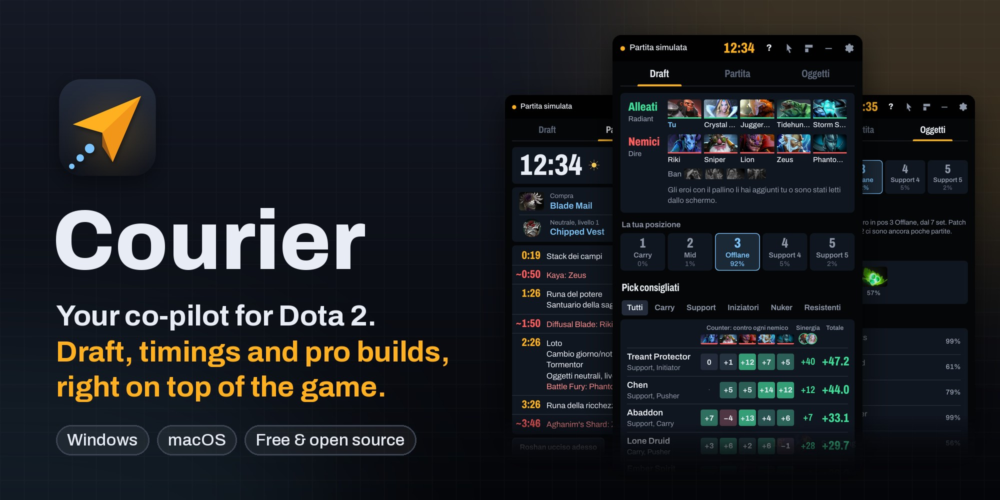
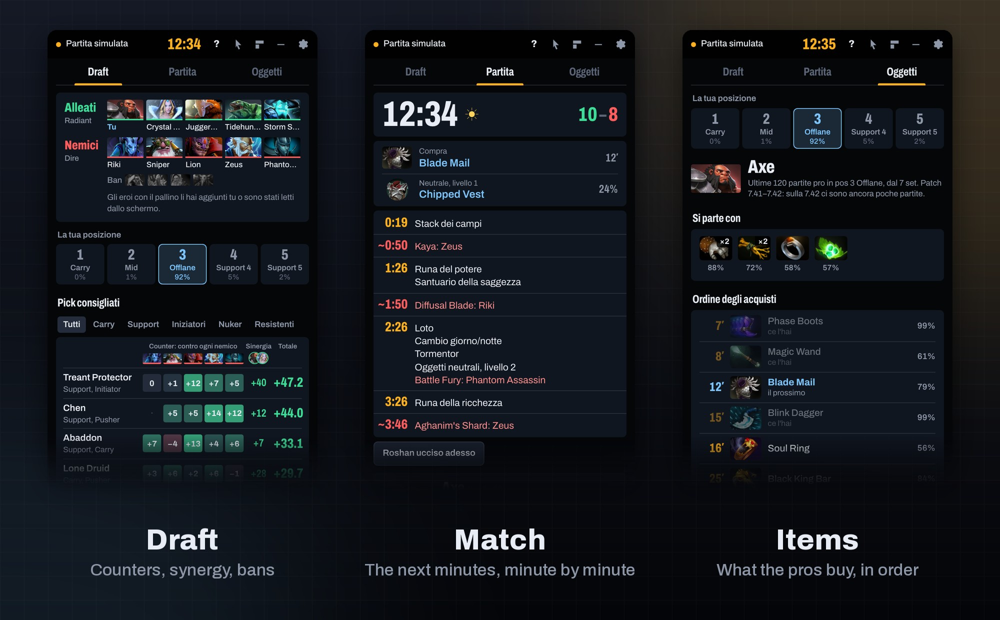
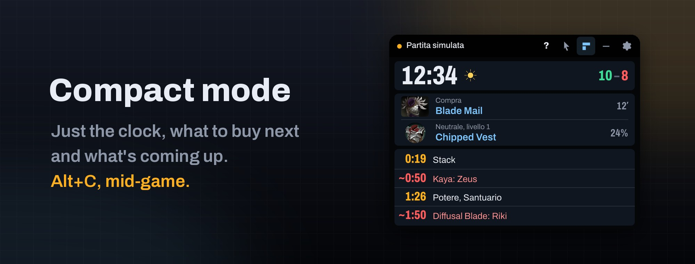
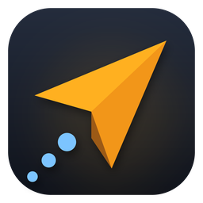

  

<h3 align="center">Draft smarter, never miss a timing, build like the pros. A small window that sits on top of Dota 2 and tells you what's next.</h3>

  
  
  
  

  <a href="https://github.com/IsThisDemi/Courier/releases/latest"><b>⬇︎ Download</b></a> ·
  <a href="docs/INSTALL.md"><b>Install &amp; first match</b></a> ·
  <a href="docs/DEVELOPMENT.md"><b>Build it yourself</b></a>

 

**Courier is the friend on voice who always knows the timings.** It reads
the match through Valve's official Game State Integration, pulls fresh pro
data from OpenDota, and keeps it all in one slim, see-through window next
to your minimap. Made for players with **a single screen**.

## ✦ Three tabs, one for every phase of the game

  

<table>
<tr>
<td width="33%" valign="top">

### 🎯 Draft
Your team and theirs, read straight from the game. Every candidate hero is
scored **against each enemy**, **with your allies** and on the **current
meta**, so the best pick is at the top. **Suggested bans** while the draft
runs, your **usual heroes** from your OpenDota profile, and the **position**
the pros play your hero in.

</td>
<td width="33%" valign="top">

### ⏱️ Match
A departure board for the next minutes: **runes, wisdom shrines, lotus,
stacks, Tormentor, neutral tiers, day and night**, plus the items the
**enemies usually finish** around that minute. **Roshan and Aegis** timers
start on their own when the game reports the kill. When the match ends, a
**recap** from OpenDota compares you with other players of your hero.

</td>
<td width="33%" valign="top">

### 🛡️ Items
The **pro build** for your hero **in your position, on this patch**:
starting items, purchase order with the usual minute, situational picks,
**skill order**, the **neutral items** to choose at each tier, what to buy
**against this lineup**, and a guess at what the **enemies will buy**,
with the answer to their key items.

</td>
</tr>
</table>

## ✦ Built for one screen

  

- **Always on top, see-through.** Borderless and semi-transparent (you pick
  how much); the text stays crisp.
- **Clicks go through when you want.** Press **Alt+T** and your clicks reach
  the game through the window, or let Courier do it by itself: clickable in
  the draft, invisible to the mouse during the match.
- **Compact mode.** **Alt+C** shrinks it to the clock, your next item and
  what's coming up.
- **Hands on the keyboard.** **Alt+D** shows or hides it, **Alt+1/2/3**
  switches tab, **Alt+R** marks Roshan as dead right now.

## ✦ Plays fair

- Game data comes **only from Valve's Game State Integration**, the
  official channel Dota 2 offers to tools like this one. Courier never
  reads the game's memory, never injects anything and never touches your
  inputs.
- The player GSI doesn't include other players' picks, so Courier can
  **recognize the ten hero portraits from your screen**, locally, on your
  machine. Nothing leaves your computer except requests to OpenDota and
  Steam's image servers.
- **No account, no sign-up, no ads.** An OpenDota API key is optional.

## ✦ Get it

Grab the latest build from the
**[Releases page](https://github.com/IsThisDemi/Courier/releases/latest)**:

| | File |
|---|---|
| 🖥️ **Windows** | `Courier-…-windows-setup.exe`, or `Courier-…-windows-portable.exe` to run without installing |
| 🍎 **Mac** (Apple Silicon) | `Courier-…-mac-arm64.dmg` |

On first launch Courier finds Dota 2 and connects to it on its own. The
**[install guide](docs/INSTALL.md)** covers the one launch option Dota
needs and the first-launch warnings, since the builds aren't signed.

> The interface is in **Italian** for now. The data it shows (heroes,
> items, numbers) reads the same in any language.

---

Courier is an independent, non-commercial fan project, not affiliated
with or endorsed by Valve. Dota 2 is a trademark of Valve Corporation; hero
and item images belong to Valve. Pro data comes from
[OpenDota](https://www.opendota.com). The code is released under the
[MIT license](LICENSE); the Archivo font keeps its own (SIL OFL).

  
   
  Made by a Dota player, for Dota players.

